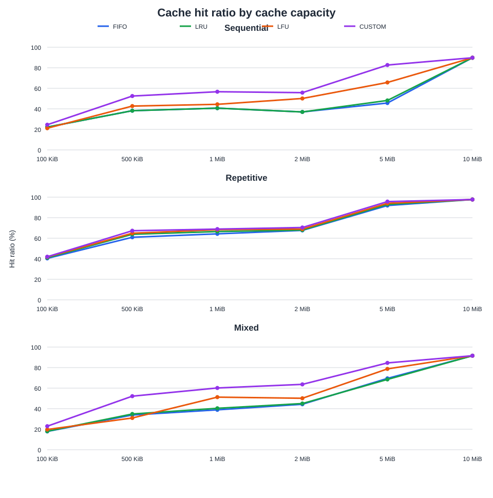
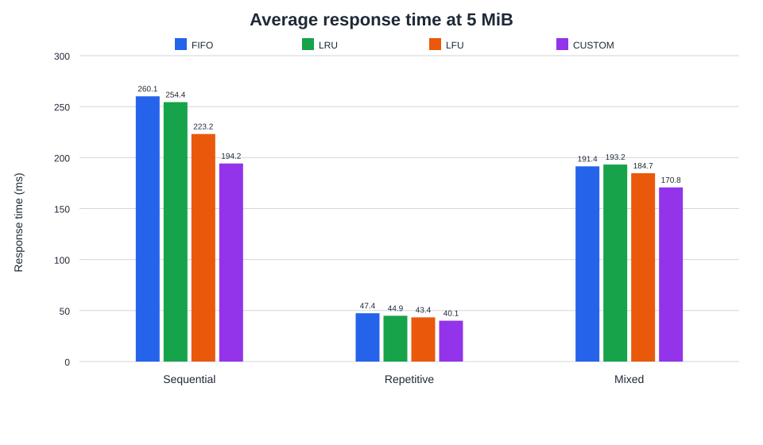
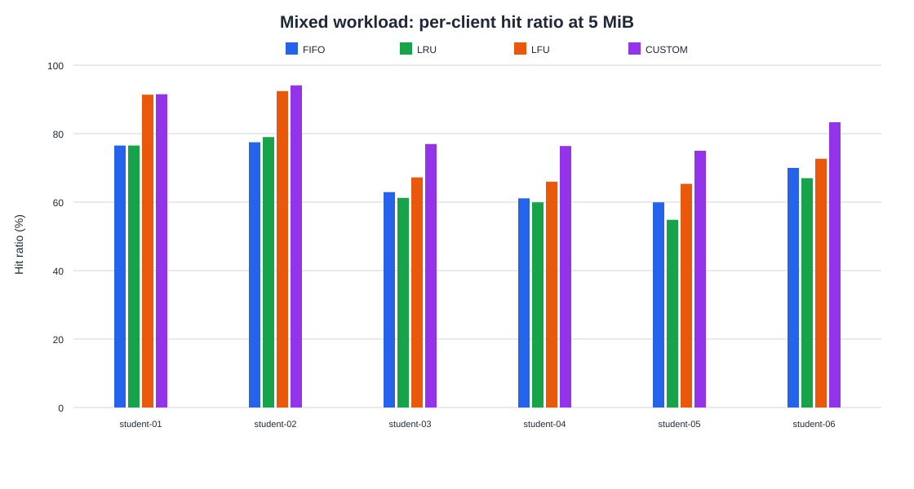
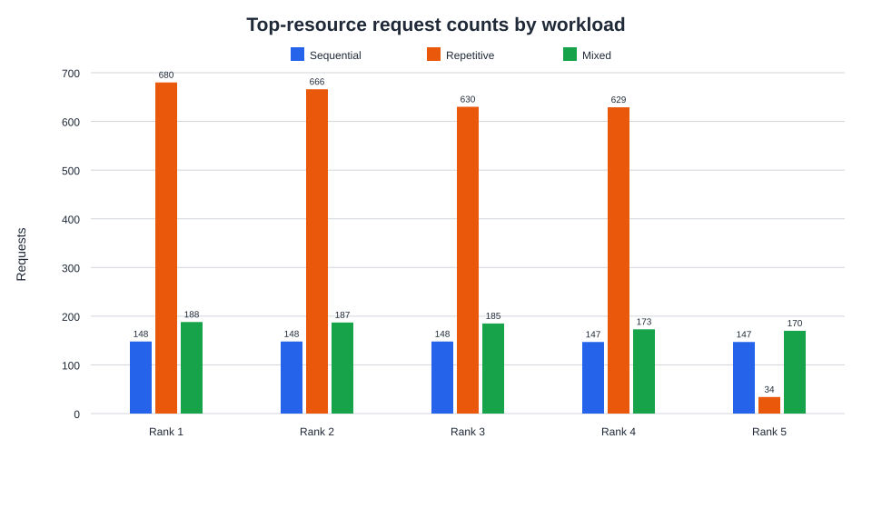

# Shared Web Cache Simulator: Experiments and Findings

## 1. Project and implementation

This project simulates a shared HTTP cache by processing request traces in
order. It does not contact websites or store response bodies. The cache keeps
resource metadata, tracks occupied bytes, and asks a replacement policy which
resource to remove when space is needed.

The simulator implements FIFO, LRU, LFU, and a custom policy. It reports the
request hit ratio, byte-hit ratio, average response time, origin traffic,
evictions, oversized requests, average cache utilization, and global and
per-client statistics. Cache hits use a fixed 5 ms response time. Misses use
the origin latency in resources.csv and add the resource size to origin
traffic. The cache starts empty; requests are processed sequentially; expiry
is disabled.

The reference trace was run at 100 KiB. FIFO, LRU, and LFU matched the
provided expected CSV files for every request. The regression check verifies
the request result, evictions, cache contents, used space, response time, and
cumulative totals. The reference summary also matched: FIFO recorded 3 hits,
412 KiB of origin traffic, and a 95.33 ms mean response time; LRU recorded
3 hits, 394 KiB, and 92.33 ms; LFU recorded 4 hits, 362 KiB, and 84.33 ms.

## 2. Workloads and experimental method

Each provided workload contains 3,000 requests from six clients and refers
to 21 distinct resources. The traces differ in popularity and requested data
volume:

| Workload | Requested data | Most requested resources |
| --- | ---: | --- |
| Sequential | 15.84 GB | Requests page and main.css (148 each); networking video (148); announcements and campus banner (147 each) |
| Repetitive | 4.38 GB | Lecture 08 PDF (680); logo (666); app.js (630); course index (629) |
| Mixed | 14.04 GB | MDN main.css (188); university main.css (187); app.js (185); intro video (173); cache-replacement PDF (170) |

The sequential trace spreads requests relatively evenly across resources.
The repetitive trace concentrates most requests on four resources. The mixed
trace combines repeated page and asset requests with large media requests.

The experiment runner compares all four policies at 100 KiB, 500 KiB, 1 MiB,
2 MiB, 5 MiB, and 10 MiB. It writes a summary CSV for all 72 workload-policy-
capacity combinations, separate per-client results for the mixed workload at
5 MiB, a workload-characterization CSV, and charts.

At 5 MiB, 288 sequential requests, 50 repetitive requests, and 234 mixed
requests were for resources larger than the cache. These requests always go
to the origin and are never stored. Large video resources explain why the
byte-hit ratios remain much lower than the request hit ratios.

The run also records average cache utilization. At 5 MiB, utilization ranges
from 69.87% to 84.15% in sequential, 77.59% to 82.35% in repetitive, and
77.49% to 83.96% in mixed. The oversized-request count is the same for all
policies at a given capacity because it depends on resource size, not victim
selection.

## 3. Policy comparison at 5 MiB

| Workload | Policy | Hit ratio | Byte-hit ratio | Avg. response | Origin traffic | Evictions |
| --- | --- | ---: | ---: | ---: | ---: | ---: |
| Sequential | FIFO | 45.67% | 2.86% | 260.10 ms | 14,671.33 MiB | 1,324 |
| Sequential | LRU | 48.17% | 3.02% | 254.39 ms | 14,646.41 MiB | 1,251 |
| Sequential | LFU | 65.70% | 3.23% | 223.16 ms | 14,614.94 MiB | 724 |
| Sequential | Custom | 82.67% | 3.73% | 194.23 ms | 14,540.23 MiB | 214 |
| Repetitive | FIFO | 91.83% | 38.77% | 47.40 ms | 2,557.60 MiB | 184 |
| Repetitive | LRU | 92.93% | 39.33% | 44.91 ms | 2,534.13 MiB | 151 |
| Repetitive | LFU | 94.00% | 39.42% | 43.35 ms | 2,530.35 MiB | 117 |
| Repetitive | Custom | 95.67% | 39.45% | 40.07 ms | 2,529.30 MiB | 64 |
| Mixed | FIFO | 69.50% | 5.19% | 191.44 ms | 12,693.19 MiB | 672 |
| Mixed | LRU | 68.47% | 5.16% | 193.18 ms | 12,697.28 MiB | 699 |
| Mixed | LFU | 78.73% | 5.03% | 184.69 ms | 12,714.92 MiB | 389 |
| Mixed | Custom | 84.57% | 4.91% | 170.76 ms | 12,731.59 MiB | 211 |

The custom policy has the highest request hit ratio and lowest mean response
time in all three workloads at 5 MiB. Its advantage is strongest in the
sequential trace, where it retains small resources with high retrieval cost.
In the repetitive trace, all policies benefit from repeated use, and their
results become closer.

The policy with the most request hits does not always minimize network
traffic. In the mixed trace, FIFO produces the least origin traffic and the
highest byte-hit ratio, while the custom policy has many more request hits
and a lower average response time. This happens because request hit ratio
counts a hit on a small file the same as a hit on a large file. The oversized
videos also contribute substantial bytes but cannot be cached.

The custom policy combines origin latency per KiB, frequency, recency, and
approximate client diversity into a retention score. It evicts the resource
with the lowest score. This favors resources that are expensive to retrieve,
small, recently used, popular, or shared across clients. It also evicted
fewer resources than the conventional policies at 5 MiB in each workload.

## 4. Capacity and client effects

Increasing capacity improves performance for every workload. At 5 MiB,
the custom policy's hit ratios are 82.67% sequential, 95.67% repetitive, and
84.57% mixed. At 10 MiB, all four policies converge to the same results in
each trace: 89.77%, 97.70%, and 91.57%, respectively. At this capacity, all
resources small enough to fit can remain cached; the very large videos still
exceed the cache.

The mixed workload also shows that global improvements do not help every
client equally. At 5 MiB, custom has a lower overall average response time
than LFU (170.76 ms versus 184.69 ms). However, students 01 and 02 have
slightly higher mean response times under custom than under LFU (81.56 vs.
73.84 ms, and 53.39 vs. 50.60 ms). The other four clients improve under
custom. This is a trade-off in a shared cache: better global results do not
guarantee an improvement for every user.

## 5. Conclusions and limitations

There is no single best policy for every metric. At 5 MiB, custom has the
best request hit ratio and mean response time, while FIFO has the lowest
origin traffic and highest byte-hit ratio in the mixed workload. LFU is a
strong conventional policy when popularity is stable. At 10 MiB, capacity
dominates policy choice for these traces because the cache can retain every
resource that fits.

The custom policy's client-sharing sketch is a 64-bit approximation, so
different client IDs can map to the same bit. Its score weights are also
chosen for this project and may behave differently on other workloads.
Oversized videos remain misses regardless of replacement policy. Future
work could test more traces, compare a wider range of capacities, and tune
the custom score using a separate training workload.

## Figures and reproducibility

Run make test to repeat unit and reference-trace checks. Run
python3 run_experiments.py to regenerate all experiment CSV files and charts.
